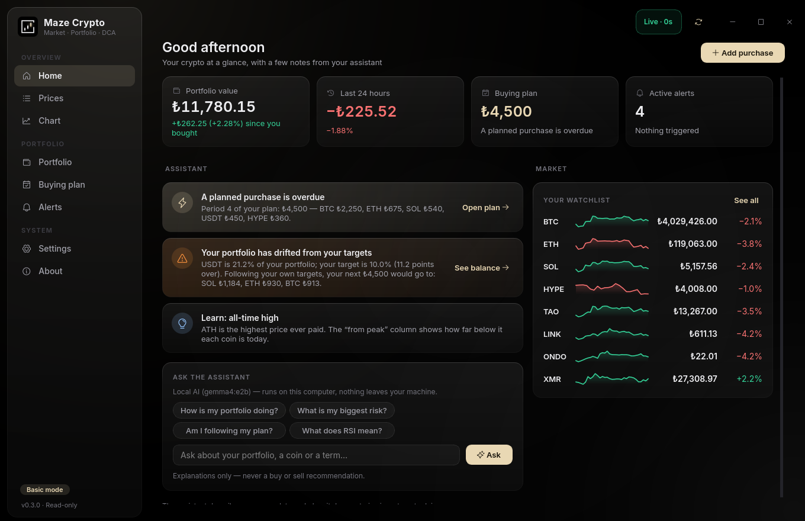
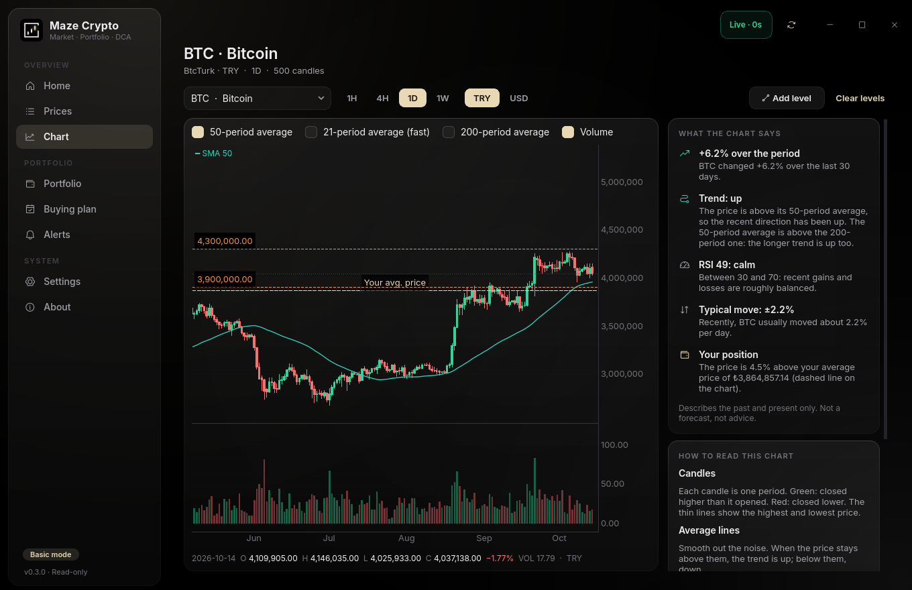
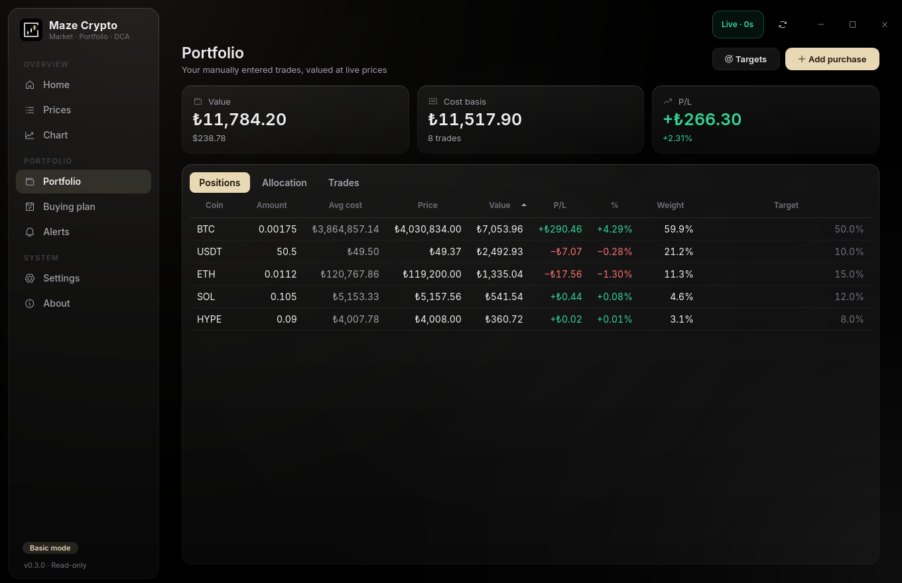
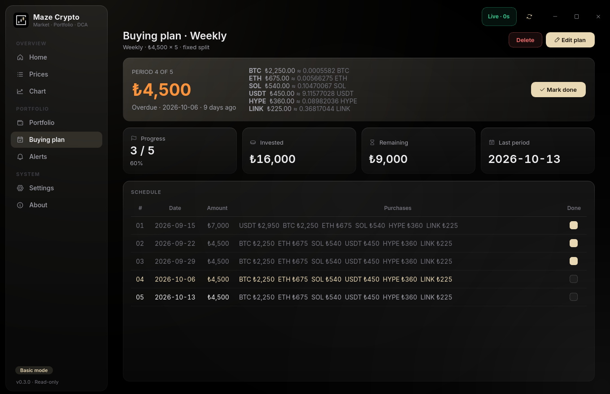
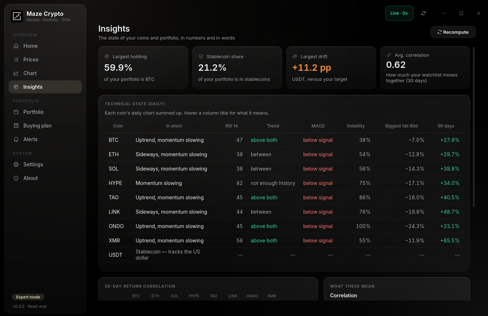
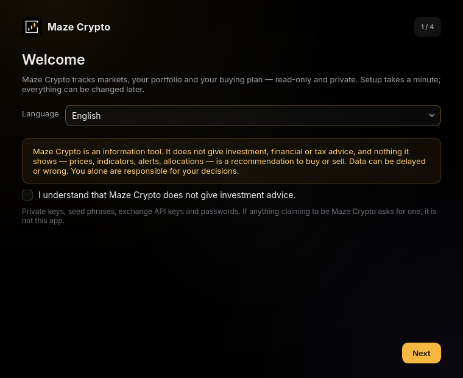

<div align="center">


<br/>

**Maze Crypto** — a read-only crypto market, portfolio and DCA tracker for Maze Linux

[](https://python.org)
[](https://pypi.org/project/PyQt6/)
[](LICENSE)

</div>

---



Maze Crypto shows live prices from the exchanges you actually use, reads the
balances of the wallet addresses you watch, values the purchases you enter by
hand, keeps you on your own buying plan, and explains what the numbers mean in
plain words. It **never trades**: it has no place for
exchange API keys, private keys or seed phrases, and never asks for them.

> **Not investment advice.** Maze Crypto is an information tool. Nothing it
> shows — prices, indicators, tips, alerts, allocations — is a recommendation
> to buy or sell, and the data can be delayed or wrong.

## Basic and expert mode

Maze Crypto opens in **basic mode**: home, prices, a chart with one average and
volume, portfolio, buying plan and simple alerts — everything explained as you
go. **Expert mode** (Settings → Experience) adds the Insights page, RSI and MACD
panes, correlation / market-cap / source columns, every alert type, exchange
priority, the Tor/SOCKS5 proxy, profiles, import/export and the yearly tax
report.

## The assistant

The home page shows a handful of **tips computed on your computer** from your
own data: a planned purchase that is due, how far you are from the target mix
you chose (and, by your own targets, where your next contribution would go),
a coin that moved sharply, a holding below what you paid, missing data — plus
one short lesson a day (DCA, average cost, correlation, RSI, drawdown…). Tips
describe your situation and your plan; they never tell you what to buy or sell.

**Ask the assistant (optional, local AI).** If [Ollama](https://ollama.com) is
running — it is what Maze-AI uses, and Maze Crypto picks the same model — a box
on the home page answers questions such as "What is my biggest risk?" or "What
does RSI mean?". The question and a compact summary of your portfolio go only to
Ollama on `127.0.0.1`; remote hosts are refused and the proxy is never used. The
model is instructed not to give buy/sell recommendations or price forecasts.

## Features

- **Prices** — any coin on CoinGecko; price in your currency, 24h / 7d change,
  a 30-day sparkline and distance from the all-time high. Expert mode adds a
  second currency, 30-day change, 30-day correlation with BTC, market cap and
  the source of each price
- **Chart** — candlesticks on 1H / 4H / 1D / 1W with averages and volume (RSI and
  MACD in expert mode), your **average buy price as a gold line**, your own
  support/resistance lines, and a side panel that says in sentences what the
  chart shows and how to read it
- **Portfolio** — manual buys and sells with fee, platform and a "why" note;
  average cost and profit/loss (also in USD at each trade's rate), target vs.
  actual allocation with the amount needed to rebalance, and a calculator that
  splits new money toward your targets
- **Wallets** (Portfolio → Wallets) — watch any number of public addresses per
  coin. Bitcoin, Litecoin, Ethereum (+ Base, Arbitrum, Optimism, Polygon),
  Hyperliquid (spot, perp margin, staked HYPE and HyperEVM), Solana and TRON are
  read from the blockchain — balances, known tokens (USDT, USDC, …) and recent
  transfers; Monero and anything else take a balance you enter. Wallet amounts
  become the portfolio's amounts; recorded trades still give the average cost
  and profit/loss. Each chain has several public providers, tried in turn until
  one answers. Only public addresses: recovery phrases, private keys and xprv
  are recognised and refused (and wiped from the clipboard), every address is
  checksum-verified, and airdropped spam and zero-value "poisoning" transfers
  are left out
- **Buying plan (DCA)** — weekly, two-weekly or monthly; a fixed split or one
  that follows your targets; one-off extras; a "this period" card and a
  schedule with check-offs that can record the purchases for you
- **Alerts** — desktop notifications when a rule becomes true: price level,
  price vs. your average cost and fast moves (plus allocation drift, RSI and
  SMA crosses in expert mode). One notification per event, with a cooldown
- **Insights** (expert) — each coin's daily chart summed up in words, RSI,
  trend, MACD, volatility, biggest fall, a correlation heatmap and portfolio
  concentration, with an explanation next to every measure
- **Import / export** (expert) — trades as CSV or JSON, and a yearly
  realised-P/L CSV (average-cost basis) for tax paperwork
- **English and Turkish** interface, English by default
- **Maze look** — OLED black, glass cards, Inter and one accent colour —
  champagne by default; monochrome white, gold or violet in Settings → Experience.
  Green and red only ever mean up and down. A frameless window with rounded
  corners (square while maximised; needs a compositor, as KDE Plasma has)

| Chart | Portfolio |
| --- | --- |
|  |  |
| **Buying plan** | **Insights (expert)** |
|  |  |

## Data sources

All public endpoints, no keys or accounts:

| Purpose | Source |
| --- | --- |
| Exchange prices and candles | Binance, Kraken, Coinbase, BtcTurk, Paribu — you pick which and in what order |
| Market data (ATH, supply, market cap, 7d/30d change), search | CoinGecko |
| Exchange rates | TCMB (TRY), ECB (other majors), CoinGecko USDT as a last resort |
| Bitcoin / Litecoin wallets | Blockstream, then mempool.space; litecoinspace |
| Ethereum and EVM wallets | Blockscout (Ethereum: balances, tokens, history), then public nodes — publicnode, 1rpc, drpc and each network's own RPC |
| Solana wallets | Solana RPC, then publicnode; Jupiter for token names and prices |
| TRON / Hyperliquid wallets | TronGrid; Hyperliquid's info API and HyperEVM RPC |

**Fallbacks.** A fiat price comes from the first of your exchanges that lists
the pair, otherwise USD price × exchange rate. An exchange price that disagrees
with CoinGecko by more than 25 % is ignored (usually two tokens sharing a
ticker, or a delisted pair with a frozen price). Every response is cached in
SQLite; if a source fails, the last good value is shown and the title bar says
**STALE** or **OFFLINE** with its age. On start the window paints from the cache
immediately and refreshes in the background. Wallet lookups try each provider
of a chain in turn until one answers; a node that reports the wrong chain is
skipped, and when none answers the wallet keeps its last balance, marked stale.

## Privacy

- No telemetry, no analytics, no accounts.
- The HTTP layer refuses any host that is not on the list above (see *About* in
  the app for the exact list) and only speaks HTTPS.
- **Tor / SOCKS5:** Settings → Network routes every request through a proxy.
  Use `socks5h://127.0.0.1:9050` so DNS goes through Tor as well; *Test* checks
  it before you save.
- Trades, watched addresses and settings stay on your disk:
  `~/.config/maze-crypto/config.toml` and `~/.local/share/maze-crypto/profiles/`.
- **Wallets:** only public addresses. Recovery phrases, private keys and xprv
  are recognised, refused and wiped from the clipboard. Reading a balance sends
  the address to that chain's public explorer, which can link it to your IP —
  use the proxy to keep it out.

## Install

### Maze Linux / Arch (makepkg)

```bash
./build-pkg.sh --install
```

This builds `dist-pkg/maze-crypto-<version>-1-any.pkg.tar.zst` from the working
tree and installs it with pacman. The package runs in the shared Maze Python
environment (`maze-python`) and pulls `python-pyqtgraph`, `python-socksio` and `python-qtawesome`
from the Arch repositories. Start it from the app menu or with `maze-crypto`.

### Any distribution (pipx)

```bash
pipx install .
```

```bash
maze-crypto
```

pipx installs the pinned versions from `pyproject.toml` (this pulls PyQt6's own
copy of Qt). For a menu entry:

```bash
install -Dm644 packaging/maze-crypto.desktop ~/.local/share/applications/maze-crypto.desktop
```

```bash
install -Dm644 mazecrypto/assets/maze-crypto.svg ~/.local/share/icons/hicolor/scalable/apps/maze-crypto.svg
```

## First start

A four-step setup (with the not-advice notice to confirm) asks for the interface language, your currency, the exchanges
you use (TRY → BtcTurk + Binance, EUR → Kraken + Coinbase are pre-selected),
the proxy, and a starting watchlist. Target allocation and a rebalance reminder
are optional. Everything can be changed later in **Settings**; *Run setup again*
brings the wizard back.



## Configuration

`~/.config/maze-crypto/config.toml` is written by the app and safe to edit:

```toml
language = "en"            # en | tr
fiat = "TRY"               # portfolio currency
secondary_fiat = "USD"     # optional second price column, "" for none
exchanges = ["btcturk", "binance"]   # priority order
refresh_seconds = 60
notifications = true
expert = false             # basic mode unless true
ai_enabled = true          # local Ollama assistant, used only when Ollama runs
ai_model = ""              # "" = Maze-AI's model, else the first one installed
profile = "default"

[proxy]
enabled = false
url = "socks5h://127.0.0.1:9050"

[[watchlist]]
id = "bitcoin"             # CoinGecko id
symbol = "BTC"
name = "Bitcoin"
```

Trades, watched wallets, targets, rules and the DCA plan live in the profile
database, not here.

## Keyboard

| Key | Action |
| --- | --- |
| `Ctrl+1` … `Ctrl+9` | Switch page (in sidebar order) |
| `F5` / `Ctrl+R` | Refresh now |
| `Ctrl+K` | Add a coin to the watchlist |
| `Ctrl+N` | New trade |
| `Ctrl+,` | Settings |
| `H` `4` `D` `W` | Chart interval (on the chart page) |
| `Ctrl`+click | Add a support/resistance line at that price |
| `Ctrl+Q` | Quit |

## Development

```bash
python -m venv --system-site-packages .venv
```

```bash
.venv/bin/pip install -e '.[dev]'
```

```bash
.venv/bin/pytest
```

```bash
ruff check .
```

`mazecrypto/core` (models, indicators, portfolio, DCA, rules, storage, address
validation, wallets) and `mazecrypto/providers` (HTTP, exchanges, CoinGecko, FX,
wallet explorers) have no Qt dependency
and are fully unit-tested; providers are tested against a fake network.
`MAZE_CRYPTO_DEBUG=1` logs refresh timings to stderr. `MAZE_CRYPTO_HOME=<dir>`
keeps config, data and cache under `<dir>` instead of your home directory.
Adding an exchange means one module in `mazecrypto/providers/exchanges/`
implementing `ExchangeProvider`.

Screenshots in this file are generated with
`MAZE_CRYPTO_SCREENSHOT=out.png MAZE_CRYPTO_PAGE=chart maze-crypto`. The icon
is `mazecrypto/assets/maze-crypto.svg`; `tools/make_icons.py` renders the PNGs.

## Android

[Maze Crypto for Android](https://github.com/berk-kucuk/Maze-Crypto-Mobile) is the
same app on the phone — the same sources, wallets and arithmetic — with
home-screen widgets.

## License

GPL-3.0-or-later — see [LICENSE](LICENSE).
